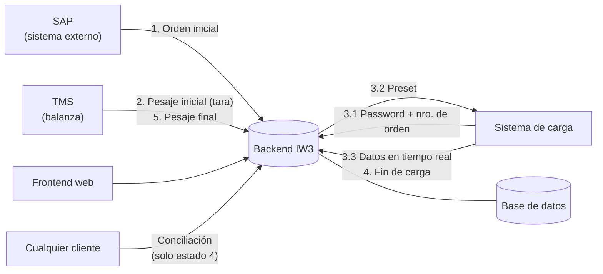
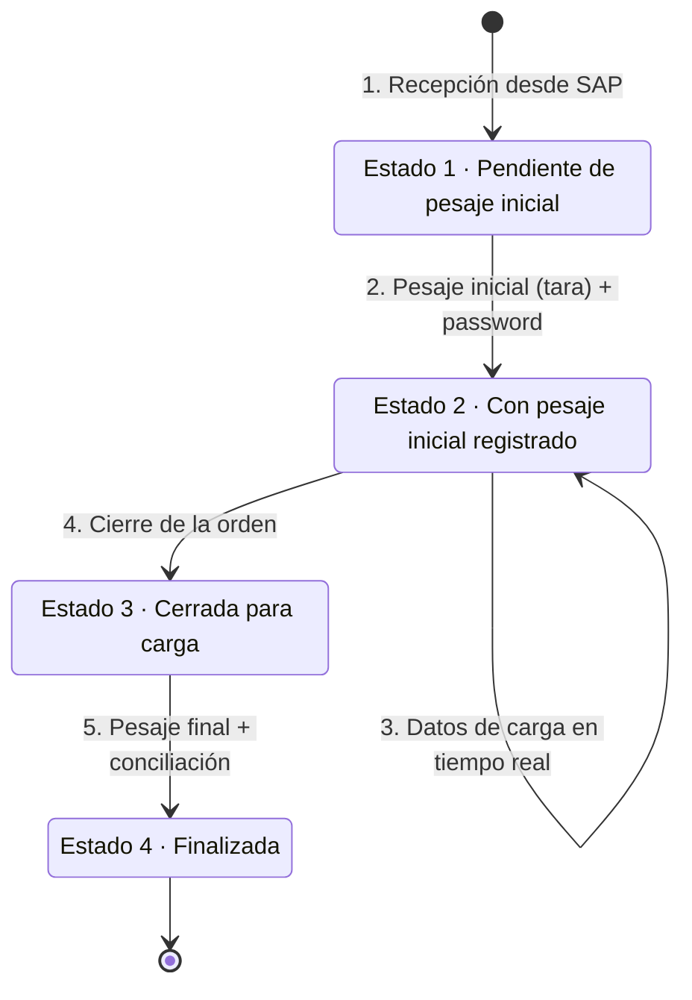

# Sistema de Gestión de Órdenes de Carga de Gas Licuado

Trabajo Integrador — **Ingeniería Web 3** · Ingeniería en Informática · IUA · 2026

Sistema para que una planta de despacho de gas licuado pueda controlar y seguir cada orden de carga de principio a fin, integrando la información que llega desde el sistema de gestión (**SAP**), la balanza (**TMS**) y el **sistema de carga**.

La idea es que:

- Solo se pueda cargar un camión que tenga una orden válida y habilitada.
- El avance de la carga se pueda monitorear en tiempo real.
- Al terminar, el sistema verifique automáticamente si lo que midió el caudalímetro coincide con lo que registró la balanza (conciliación).

Lo damos por logrado cuando una orden pueda recorrer todo su ciclo (recepción → pesaje inicial → carga → cierre → pesaje final) a través de las APIs, con cada cambio de estado registrado, y el sistema entregue la conciliación al final.

---

## Integrantes

| Integrante | Rama | Rol principal |
|---|---|---|
| Leandro Sposito | `lean` | Parcial (APIs 1 a 5); final: conciliaciones, Docker Compose, Postman y documentación |
| Fran | `fran` | Final: seguridad (Spring Security + JWT, roles) y login en el frontend |
| Fabri | `fabri` | Final: monitoreo en tiempo real y alarmas de temperatura por mail |

> Aunque cada uno tenga un área principal, todos tenemos que entender el sistema completo (la evaluación es individual). Lo que implementa cada uno se comparte con el resto.

---

## Arquitectura general



Componentes del sistema:

- **Backend**: expone las APIs de integración (SAP, TMS, sistema de carga) y la lógica de negocio. Protegido con login y roles (JWT).
- **Base de datos**: órdenes, entidades sincronizadas, detalle de carga, log de auditoría de estados, usuarios y alarmas.
- **Frontend**: login, monitoreo en tiempo real, alarmas y conciliaciones (requisito del final).
- **Mailpit**: servidor de mail de prueba que recibe las alarmas de temperatura.
- **Despliegue**: Docker Compose levanta MySQL + backend + frontend + Mailpit con un solo comando.

---

## Ciclo de vida de una orden



Reglas de los estados:

- Los cambios son **secuenciales y unidireccionales**: una orden nunca vuelve a un estado anterior.
- Cada cambio de estado queda registrado en la base (**log de auditoría**) con fecha/hora, usuario autenticado que lo hizo y observaciones si aplica.

---

## APIs

> La documentación completa (bodies, respuestas y códigos de error de cada endpoint) está en **Swagger UI**: `http://localhost:8080/swagger-ui.html` con la app levantada, o en [`docs/openapi.json`](docs/openapi.json).

| # | Método | Endpoint | Quién lo usa | Qué hace | Estado resultante |
|---|---|---|---|---|---|
| 1 | `POST` | `/api/v1/ordenes` | SAP | Recibe la orden con camión, chofer, cliente, producto, fecha prevista y preset. Sincroniza las entidades por código externo. | 1 |
| 2 | `POST` | `/api/v1/ordenes/{numeroOrden}/pesaje-inicial` | TMS | Registra la tara y genera la contraseña de activación (5 dígitos). | 2 |
| 3.1 | `POST` | `/api/v1/ordenes/{numeroOrden}/habilitar-carga` | Sistema de carga | Valida orden + estado + password y devuelve el preset. | 2 |
| 3.3 | `POST` | `/api/v1/ordenes/{numeroOrden}/detalle` | Sistema de carga | Recibe masa acumulada, densidad, temperatura y caudal en tiempo real. Responde si el dato fue aceptado, almacenado o descartado (y por qué). | 2 |
| 4 | `POST` | `/api/v1/ordenes/{numeroOrden}/cierre` | Sistema de carga | Cierra la orden y bloquea nuevos datos de detalle. | 3 |
| 5 | `POST` | `/api/v1/ordenes/{numeroOrden}/pesaje-final` | TMS | Registra el pesaje final y devuelve la conciliación. | 4 |
| — | `GET` | `/api/v1/ordenes/{numeroOrden}/conciliacion` | Cualquier cliente | Devuelve la conciliación. Solo para órdenes en estado 4. | — |
| — | `GET` | `/api/v1/ordenes?estado=` | Consulta | Lista órdenes (filtro opcional por estado). | — |
| — | `GET` | `/api/v1/ordenes/{numeroOrden}` | Consulta | Orden completa con la cabecera de últimos valores (no expone la password). | — |
| — | `GET` | `/api/v1/ordenes/{numeroOrden}/historial-estados` | Consulta | Log de auditoría de estados. | — |
| — | `GET` | `/api/v1/ordenes/{numeroOrden}/detalle` | Consulta | Detalle de carga almacenado. | — |
| — | `POST` | `/api/v1/auth/login` | Todos | Usuario y contraseña → token JWT. | — |
| — | `GET` | `/api/v1/monitoreo` | Frontend | Últimos valores de cada orden con ETA y tiempo transcurrido. Filtros `estado` y `patente`, orden `ordenarPor` y `direccion`. | — |
| — | `GET` | `/api/v1/alarmas?estado=` | Frontend | Lista las alarmas de temperatura. | — |
| — | `POST` | `/api/v1/alarmas/{id}/aceptar` | Operador / Admin | Acepta una alarma registrando usuario, fecha/hora y observación. | — |
| — | `GET` | `/api/v1/alarmas/configuracion` | Admin | Umbral de temperatura y destinatarios vigentes. | — |
| — | `PUT` | `/api/v1/alarmas/configuracion` | Admin | Cambia umbral y destinatarios (rige desde el próximo dato, sin reiniciar). | — |

Códigos de error (todos con el mismo formato JSON: `timestamp`, `status`, `error`, `mensaje`, `path`, `detalles`):

| Código | Cuándo |
|---|---|
| `400` | Faltan datos o tienen formato inválido (Bean Validation). |
| `401` | Sin token, token inválido o vencido, usuario/contraseña incorrectos, o contraseña de activación incorrecta. |
| `403` | El rol del usuario no tiene permiso para ese endpoint. |
| `404` | La orden o la alarma no existe. |
| `409` | La operación no corresponde al estado actual de la orden, el número de orden ya existe, o la alarma ya estaba aceptada. |

### Seguridad y roles

Se hace login en `POST /api/v1/auth/login` y el token se envía en cada request como `Authorization: Bearer <token>`. Todo requiere token salvo el login y Swagger.

| Rol | Usuario de demo | Qué puede hacer |
|---|---|---|
| `SAP` | `sap` | Crear órdenes. |
| `TMS` | `tms` | Pesaje inicial y pesaje final. |
| `SISTEMA_CARGA` | `carga` | Habilitar carga, enviar datos de carga y cerrar la orden. |
| `OPERADOR` | `operador` | Consultas y aceptar alarmas. |
| `ADMIN` | `admin` | Todo. |

Cualquier usuario logueado puede hacer las consultas (`GET`). Todos los usuarios de demo tienen la contraseña `demo1234` por defecto (solo para desarrollo; se cambia con la variable `PASSWORD_DEMO`).

### Alarmas de temperatura

Si un dato de carga válido supera el umbral (40 °C por defecto) se crea una alarma y se envía un mail a los destinatarios configurados. El umbral y los destinatarios se guardan en la base y los edita el `ADMIN` desde el formulario de la pantalla **Alarmas** (o con `PUT /api/v1/alarmas/configuracion`), sin reiniciar; las variables `ALARMA_TEMPERATURA_UMBRAL` y `ALARMA_DESTINATARIOS` son solo el valor inicial. No se vuelve a enviar otro mail de esa orden hasta que un operador o administrador acepte la alarma. Con Docker Compose, los mails se ven en http://localhost:8025 (Mailpit).

---

## Reglas de negocio clave

**Integración con sistemas externos**
- Toda entidad que viene de afuera (camión, chofer, cliente, producto) se identifica con un **código externo de tipo `string`**, para no atarnos rígidamente a los IDs de otros sistemas.

**Habilitación de carga (punto 3.1)**
- Solo se devuelve el preset si la orden existe, está en estado 2 y la contraseña es correcta.

**Datos de carga en tiempo real (punto 3.3)**
- Se **descartan** los registros con:
  - Caudal ≤ 0
  - Masa acumulada ≤ 0, o menor que el valor anterior
  - Densidad fuera de (0, 1] _(interpretación nuestra, ver [decisiones](docs/decisiones.md))_
- En la cabecera de la orden se guarda siempre el **último valor válido** (masa, densidad, temperatura, caudal y timestamp).
- El detalle histórico se almacena según una **frecuencia configurable**, que puede ser distinta a la de recepción.
  _Ejemplo: si llegan datos cada 1 s y se guarda cada 10 s, en un minuto llegan 60 registros y se guardan 6._
- Inicio de carga = primer registro válido. Fin de carga = último registro válido.

**Conciliación (punto 5)**

| Dato | Cálculo |
|---|---|
| Pesaje inicial | Tara |
| Pesaje final | Pesaje recibido del TMS |
| Producto cargado | Último valor de masa acumulada |
| Neto por balanza | Pesaje final − Pesaje inicial |
| Diferencia balanza vs. caudalímetro | Neto por balanza − Producto cargado |
| Promedios | Temperatura, densidad y caudal (sobre los datos almacenados) |

---

## Modelo de datos (resumen)

| Entidad | Atributos principales (`*` = opcional) |
|---|---|
| **Camión** | Código externo, patente, descripción\*, cisternado (capacidad de cada cisterna y total) |
| **Chofer** | Código externo, nombre, apellido, documento\* |
| **Cliente** | Código externo, razón social, contacto\* |
| **Producto** | Código externo, nombre, descripción\* |
| **Orden** | Número de orden, camión, chofer, cliente, producto, fecha prevista, preset, tara, pesaje final, password, estado, fechas de cada evento, últimos valores de carga |
| **Detalle de carga** | Masa acumulada, densidad, temperatura, caudal, timestamp |
| **Log de estados** | Orden, estado anterior, estado nuevo, fecha/hora, usuario, observaciones |
| **Usuario** | Username, hash de la contraseña (BCrypt), rol |
| **Alarma** | Orden, temperatura, umbral, fecha/hora, estado (pendiente/aceptada), usuario, fecha y observación de la aceptación |

El modelo es extensible: se pueden agregar propiedades según lo que vaya necesitando el negocio o la integración.

---

## Entregas y requisitos

### Segundo parcial — primera entrega: **10/11/2026**

- [x] APIs de los puntos 1 a 5 (sin interfaz gráfica)
- [x] Documentación con OpenAPI (Swagger)
- [x] Colección de Postman para probar todas las APIs
- [x] _(Opcional)_ Tests de Postman que simulen el circuito completo de una orden
- [x] _(Opcional)_ Frecuencia de almacenamiento de detalle configurable
- [x] _(Opcional)_ Cálculo de promedios de temperatura, densidad y caudal

### Examen final

- [x] 100 % de los endpoints implementados
- [x] Seguridad y roles de usuario para consumir las APIs _(Spring Security + JWT)_
- [x] Alarma de temperatura por email
  - [x] Umbral y destinatarios configurables _(guardados en la base, editables por el admin desde la pantalla de alarmas)_
  - [x] No se vuelve a enviar hasta que un usuario autorizado la acepte
- [x] Frontend web
  - [x] Login
  - [x] Monitoreo en tiempo real de órdenes (nro., estado, camión, preset, carga actual, última temperatura / densidad / caudal)
  - [x] Filtros y ordenamiento
  - [x] ETA de llenado: `(preset − masa acumulada) / caudal` → horas
  - [x] Tiempo transcurrido desde el inicio de carga (solo estado 2)
  - [x] Gestión de alarmas: verlas, aceptarlas, registrar usuario, fecha/hora y observación
  - [x] Visualización de conciliaciones (solo estado 4)
- [x] Despliegue con Docker Compose (MySQL + backend + frontend + Mailpit)
- [x] Colección de Postman con login y el resto de los requests usando el token

---

## Stack tecnológico

| Capa | Tecnología |
|---|---|
| Backend | Java 21 + Spring Boot 4.1 (Spring Web MVC, Spring Data JPA / Hibernate, Bean Validation, Spring Security, Spring Mail) |
| Seguridad | Spring Security + JWT (jjwt), contraseñas con BCrypt |
| Base de datos | MySQL 8 (H2 en memoria para pruebas rápidas y tests) |
| Frontend | Vue 3 + Vite (Vue Router, Pinia) |
| Documentación de API | OpenAPI / Swagger (springdoc-openapi) |
| Pruebas de API | Postman |
| Mails de prueba | Mailpit |
| Despliegue | Docker Compose (nginx sirve el frontend) |

## Estructura del repositorio

```
├── backend/             # API y lógica de negocio (Spring Boot) + Dockerfile
├── frontend/            # Interfaz web (Vue 3 + Vite) + Dockerfile y nginx.conf
├── postman/             # Colección de Postman con login y tests del circuito completo
├── docs/                # Enunciado, especificación OpenAPI, decisiones de diseño y explicación de cada parte
├── docker-compose.yml   # Levanta todo el sistema con un comando
└── .env.example         # Variables de Docker Compose (copiar como .env para cambiarlas)
```

La explicación de cada parte del trabajo (qué se hizo, conceptos y preguntas posibles del coloquio) está en [`docs/partes/`](docs/partes): [`lean.md`](docs/partes/lean.md), [`fran.md`](docs/partes/fran.md) y [`fabri.md`](docs/partes/fabri.md).

Paquetes del backend (`backend/src/main/java/ar/edu/iua/iw3`), organizados por capa:

| Paquete | Qué tiene |
|---|---|
| `controller` | Un controller por sistema que consume la API (SAP, TMS, sistema de carga) + consultas. Solo reciben HTTP y delegan. |
| `service` | Reglas de negocio: transiciones de estado + auditoría, sincronización de maestros, reglas de descarte, conciliación, monitoreo y alarmas. |
| `security` | Login, JWT, filtro de autenticación y permisos por rol. |
| `repository` | Interfaces Spring Data JPA. |
| `model` | Entidades JPA y la máquina de estados (`EstadoOrden`). |
| `dto` / `mapper` | Contrato de entrada/salida de la API y conversión desde las entidades. |
| `exception` | Excepciones de negocio y `GlobalExceptionHandler` (las traduce a 400/401/404/409). |

Las decisiones de diseño y cómo interpretamos las partes ambiguas del enunciado están en [`docs/decisiones.md`](docs/decisiones.md).

## Cómo levantar el proyecto

### Con Docker (recomendado)

**Requisito:** Docker Desktop (o Docker + el plugin Compose). No hace falta instalar Java, Node ni MySQL.

```bash
docker compose up --build
```

La primera vez tarda unos minutos (descarga imágenes y compila). Cuando termina:

| Qué | Dónde |
|---|---|
| Pantallas web | http://localhost:3000 |
| Swagger (documentación de la API) | http://localhost:8080/swagger-ui.html |
| Mails de las alarmas (Mailpit) | http://localhost:8025 |

Entrar en http://localhost:3000 con `admin` / `demo1234` (ver la tabla de roles más arriba para los demás usuarios).

Comandos útiles:

```bash
docker compose up --build -d   # levantar en segundo plano
docker compose logs -f backend # ver el log del backend
docker compose down            # apagar (los datos de MySQL se conservan)
docker compose down -v         # apagar y borrar también los datos
```

Para cambiar la contraseña de la base, el secreto del token, el valor inicial del umbral de alarma, etc.: copiar `.env.example` como `.env` (en la raíz) y editarlo. **El `.env` no se sube al repo.** Sin `.env` se usan valores de desarrollo.

### Sin Docker (para desarrollar)

**Requisitos:** JDK 21 y Node 22 o superior. Maven no hace falta: el proyecto trae Maven Wrapper (`mvnw`).

**Backend** con base H2 en memoria (sin instalar MySQL; los datos se pierden al apagar):

```bash
cd backend
./mvnw spring-boot:run -Dspring-boot.run.profiles=h2      # Windows: mvnw.cmd ...
```

**Backend con MySQL:** tener MySQL 8 corriendo (el schema `iw3` se crea solo), copiar `backend/.env.example` a `backend/.env`, completar usuario y contraseña, y levantar con `./mvnw spring-boot:run`. **El `.env` no se sube al repo.**

**Frontend** (en otra terminal; reenvía `/api` al backend en el puerto 8080):

```bash
cd frontend
npm install
npm run dev        # http://localhost:5173
```

Para ver los mails de las alarmas sin Docker Compose: `docker run -d -p 8025:8025 -p 1025:1025 axllent/mailpit`.

### Configuración del backend

| Variable | Default | Para qué |
|---|---|---|
| `DB_URL` | `jdbc:mysql://localhost:3306/iw3?...` | URL de la base |
| `DB_USER` / `DB_PASSWORD` | `root` / _(vacío)_ | Credenciales |
| `FRECUENCIA_DETALLE_SEGUNDOS` | `0` | Cada cuántos segundos se guarda un registro de detalle (`0` = todos) |
| `JWT_SECRET` | _(valor de desarrollo)_ | Secreto para firmar los tokens (mínimo 32 caracteres) |
| `JWT_EXPIRACION_MINUTOS` | `120` | Duración del token |
| `PASSWORD_DEMO` | `demo1234` | Contraseña de los usuarios de demo |
| `ALARMA_TEMPERATURA_UMBRAL` | `40` | **Valor inicial** del umbral de alarma (grados). Después se cambia desde el sistema |
| `ALARMA_DESTINATARIOS` | `operaciones@planta.local` | **Valor inicial** de los mails que reciben la alarma (separados por coma). Después se cambian desde el sistema |
| `MAIL_HOST` / `MAIL_PORT` | `localhost` / `1025` | Servidor de mail (por defecto Mailpit) |

### Probar

- **Swagger UI:** http://localhost:8080/swagger-ui.html. Hacer login en `POST /api/v1/auth/login`, copiar el token y pegarlo en el botón **Authorize**.
- **Postman:** importar `postman/IW3-ordenes-de-carga.postman_collection.json` y correrla con el **Collection Runner** (los requests van encadenados). El primero hace login y guarda el token; el resto lo usa solo. Desde consola: `npx newman run postman/IW3-ordenes-de-carga.postman_collection.json`
- **Tests del backend:** `cd backend && ./mvnw test` (unitarios, de seguridad y de integración del circuito, el monitoreo y las alarmas).
- **Tests del frontend:** `cd frontend && npm test`. Para comprobar que compila: `npm run build`.

---

## Cómo trabajamos con Git

### Ramas

| Rama | Para qué |
|---|---|
| `main` | Versión estable. **Solo entra lo que funciona y está probado.** No se commitea directo. |
| `lean` | Rama de trabajo de Leandro |
| `fran` | Rama de trabajo de Fran |
| `fabri` | Rama de trabajo de Fabri |

### Flujo de trabajo

Cada uno trabaja en su propia rama y **no usamos Pull Requests**: el merge a `main` lo hace quien terminó, después de probar.

1. **Antes de arrancar**, traer lo último de `main` a tu rama (así no se acumulan conflictos):

   ```bash
   git fetch origin
   git checkout lean
   git pull origin lean
   git merge origin/main
   ```

2. **Trabajar y commitear seguido**, con mensajes claros y subiendo cada tanto a tu rama:

   ```bash
   git add .
   git commit -m "feat: endpoint de pesaje inicial"
   git push origin lean
   ```

3. **Cuando termina un bloque de trabajo**, correr todos los tests en tu rama (backend con `./mvnw test` en `backend/`, frontend con `npm test` y `npm run build` en `frontend/`) y probar a mano lo nuevo. Si algo falla, **no se mergea**: se arregla en la rama.
4. **Mergear a `main`** con un commit de merge (`--no-ff`, para que quede visible qué entró y de qué rama):

   ```bash
   git checkout main
   git pull origin main
   git merge --no-ff lean -m "merge: lean - resumen de lo que entra"
   ```

5. **Volver a correr los tests, ahora sobre `main`**, antes de subir. Solo si pasan:

   ```bash
   git push origin main
   ```

6. Después del merge, los demás traen los cambios a su rama con `git merge origin/main` (paso 1).

### Convención de commits

Usamos prefijos para que el historial se entienda de un vistazo:

| Prefijo | Uso |
|---|---|
| `feat:` | Funcionalidad nueva |
| `fix:` | Corrección de un bug |
| `docs:` | Documentación (README, Swagger, etc.) |
| `refactor:` | Cambios de código sin cambiar el comportamiento |
| `test:` | Tests o colecciones de Postman |
| `chore:` | Configuración, dependencias, cosas varias |

### Buenas prácticas

- Los conflictos se resuelven **en tu rama** (al hacer `git merge origin/main`), nunca en `main`.
- No se usa `git push --force`, `git reset --hard` ni `rebase` sobre ramas que ya se subieron.
- No subir credenciales, archivos `.env` ni contraseñas al repo.
- Si un cambio toca algo que está haciendo otro, avisar antes por el grupo.
