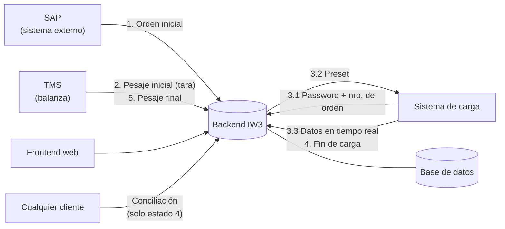
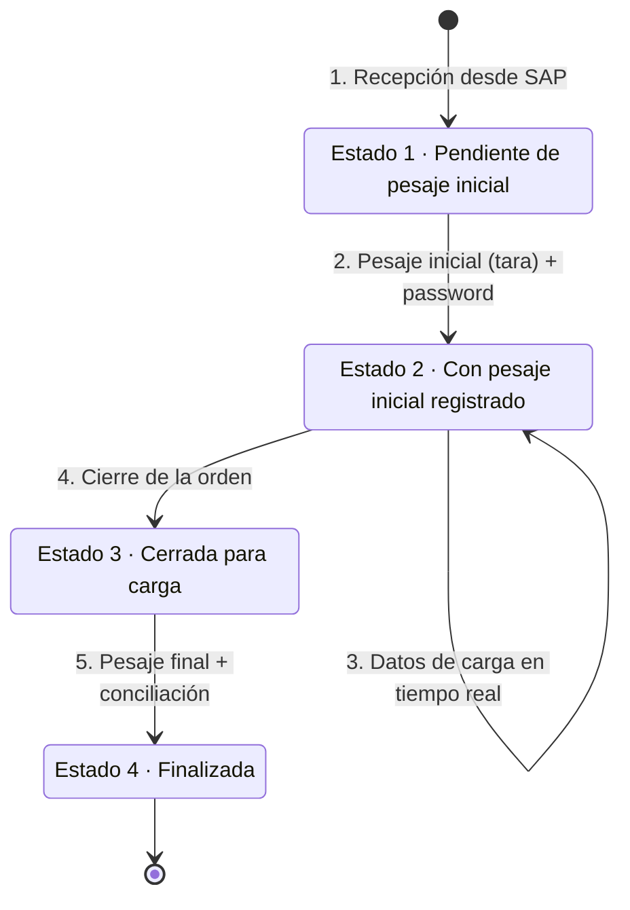

# Sistema de Gestión de Órdenes de Carga de Gas Licuado

Trabajo Integrador — **Ingeniería Web 3** · Ingeniería en Informática · IUA · 2026

Sistema para que una planta de despacho de gas licuado pueda controlar y seguir cada orden de carga de principio a fin, integrando la información que llega desde el sistema de gestión (**SAP**), la balanza (**TMS**) y el **sistema de carga**.

La idea es que:

- Solo se pueda cargar un camión que tenga una orden válida y habilitada.
- El avance de la carga se pueda monitorear en tiempo real.
- Al terminar, el sistema verifique automáticamente si lo que midió el caudalímetro coincide con lo que registró la balanza (conciliación).

Lo damos por logrado cuando una orden pueda recorrer todo su ciclo (recepción → pesaje inicial → carga → cierre → pesaje final) a través de las APIs, con cada cambio de estado registrado, y el sistema entregue la conciliación al final.

---

## Integrantes

| Integrante | Rama | Rol principal |
|---|---|---|
| Leandro Sposito | `lean` | _a definir_ |
| Fran | `fran` | _a definir_ |
| Fabri | `fabri` | _a definir_ |

> Aunque cada uno tenga un área principal, todos tenemos que entender el sistema completo (la evaluación es individual). Lo que implementa cada uno se comparte con el resto.

---

## Arquitectura general



Componentes del sistema:

- **Backend**: expone las APIs de integración (SAP, TMS, sistema de carga) y la lógica de negocio.
- **Base de datos**: órdenes, entidades sincronizadas, detalle de carga, log de auditoría de estados.
- **Frontend**: login, monitoreo en tiempo real, alarmas y conciliaciones (requisito del final).
- **Infraestructura de despliegue**: _a definir_.

---

## Ciclo de vida de una orden



Reglas de los estados:

- Los cambios son **secuenciales y unidireccionales**: una orden nunca vuelve a un estado anterior.
- Cada cambio de estado queda registrado en la base (**log de auditoría**) con fecha/hora, usuario o proceso que lo hizo y observaciones si aplica.

---

## APIs (propuesta inicial)

> Borrador para arrancar. Lo vamos ajustando cuando empecemos con el backend. La documentación "oficial" va a estar en **Swagger / OpenAPI**.

| # | Método | Endpoint | Quién lo usa | Qué hace | Estado resultante |
|---|---|---|---|---|---|
| 1 | `POST` | `/api/v1/ordenes` | SAP | Recibe la orden con camión, chofer, cliente, producto, fecha prevista y preset. Sincroniza las entidades por código externo. | 1 |
| 2 | `POST` | `/api/v1/ordenes/{numeroOrden}/pesaje-inicial` | TMS | Registra la tara y genera la contraseña de activación (5 dígitos). | 2 |
| 3.1 | `POST` | `/api/v1/ordenes/{numeroOrden}/habilitar-carga` | Sistema de carga | Valida orden + estado + password y devuelve el preset. | 2 |
| 3.3 | `POST` | `/api/v1/ordenes/{numeroOrden}/detalle` | Sistema de carga | Recibe masa acumulada, densidad, temperatura y caudal en tiempo real. | 2 |
| 4 | `POST` | `/api/v1/ordenes/{numeroOrden}/cierre` | Sistema de carga | Cierra la orden y bloquea nuevos datos de detalle. | 3 |
| 5 | `POST` | `/api/v1/ordenes/{numeroOrden}/pesaje-final` | TMS | Registra el pesaje final y devuelve la conciliación. | 4 |
| — | `GET` | `/api/v1/ordenes/{numeroOrden}/conciliacion` | Cualquier cliente | Devuelve la conciliación. Solo para órdenes en estado 4. | — |

---

## Reglas de negocio clave

**Integración con sistemas externos**
- Toda entidad que viene de afuera (camión, chofer, cliente, producto) se identifica con un **código externo de tipo `string`**, para no atarnos rígidamente a los IDs de otros sistemas.

**Habilitación de carga (punto 3.1)**
- Solo se devuelve el preset si la orden existe, está en estado 2 y la contraseña es correcta.

**Datos de carga en tiempo real (punto 3.3)**
- Se **descartan** los registros con:
  - Caudal ≤ 0
  - Masa acumulada ≤ 0, o menor que el valor anterior
- En la cabecera de la orden se guarda siempre el **último valor válido** (masa, densidad, temperatura, caudal y timestamp).
- El detalle histórico se almacena según una **frecuencia configurable**, que puede ser distinta a la de recepción.
  _Ejemplo: si llegan datos cada 1 s y se guarda cada 10 s, en un minuto llegan 60 registros y se guardan 6._
- Inicio de carga = primer registro válido. Fin de carga = último registro válido.

**Conciliación (punto 5)**

| Dato | Cálculo |
|---|---|
| Pesaje inicial | Tara |
| Pesaje final | Pesaje recibido del TMS |
| Producto cargado | Último valor de masa acumulada |
| Neto por balanza | Pesaje final − Pesaje inicial |
| Diferencia balanza vs. caudalímetro | Neto por balanza − Producto cargado |
| Promedios | Temperatura, densidad y caudal (sobre los datos almacenados) |

---

## Modelo de datos (resumen)

| Entidad | Atributos principales (`*` = opcional) |
|---|---|
| **Camión** | Código externo, patente, descripción\*, cisternado (capacidad de cada cisterna y total) |
| **Chofer** | Código externo, nombre, apellido, documento\* |
| **Cliente** | Código externo, razón social, contacto\* |
| **Producto** | Código externo, nombre, descripción\* |
| **Orden** | Número de orden, camión, chofer, cliente, producto, fecha prevista, preset, tara, pesaje final, password, estado, fechas de cada evento, últimos valores de carga |
| **Detalle de carga** | Masa acumulada, densidad, temperatura, caudal, timestamp |
| **Log de estados** | Orden, estado anterior, estado nuevo, fecha/hora, usuario/proceso, observaciones |

El modelo es extensible: se pueden agregar propiedades según lo que vaya necesitando el negocio o la integración.

---

## Entregas y requisitos

### Segundo parcial — primera entrega: **10/11/2026**

- [ ] APIs de los puntos 1 a 5 (sin interfaz gráfica)
- [ ] Documentación con OpenAPI (Swagger)
- [ ] Colección de Postman para probar todas las APIs
- [ ] _(Opcional)_ Tests de Postman que simulen el circuito completo de una orden
- [ ] _(Opcional)_ Frecuencia de almacenamiento de detalle configurable
- [ ] _(Opcional)_ Cálculo de promedios de temperatura, densidad y caudal

### Examen final

- [ ] 100 % de los endpoints implementados
- [ ] Seguridad y roles de usuario para consumir las APIs
- [ ] Alarma de temperatura por email
  - Umbral y destinatarios configurables
  - No se vuelve a enviar hasta que un usuario autorizado la acepte
- [ ] Frontend web
  - [ ] Login
  - [ ] Monitoreo en tiempo real de órdenes (nro., estado, camión, preset, carga actual, última temperatura / densidad / caudal)
  - [ ] Filtros y ordenamiento
  - [ ] ETA de llenado: `(preset − masa acumulada) / caudal` → horas
  - [ ] Tiempo transcurrido desde el inicio de carga (solo estado 2)
  - [ ] Gestión de alarmas: verlas, aceptarlas, registrar usuario, fecha/hora y observación
  - [ ] Visualización de conciliaciones (solo estado 4)

---

## Stack tecnológico

| Capa | Tecnología |
|---|---|
| Backend | _a definir_ |
| Base de datos | _a definir_ |
| Frontend | Vue o React _(a definir)_ |
| Documentación de API | OpenAPI / Swagger |
| Pruebas de API | Postman |
| Despliegue | _a definir_ |

## Estructura del repositorio (propuesta)

```
├── backend/     # API y lógica de negocio
├── frontend/    # Interfaz web (para el final)
├── postman/     # Colección y environments de Postman
└── docs/        # Diagramas, decisiones de diseño, etc.
```

## Cómo levantar el proyecto

_Pendiente: lo completamos cuando definamos el stack._

---

## Cómo trabajamos con Git

### Ramas

| Rama | Para qué |
|---|---|
| `main` | Versión estable. **Solo entra lo que funciona y está probado.** No se commitea directo. |
| `lean` | Rama de trabajo de Leandro |
| `fran` | Rama de trabajo de Fran |
| `fabri` | Rama de trabajo de Fabri |

### Flujo de trabajo

1. **Antes de arrancar**, traer lo último de `main` a tu rama (así no se acumulan conflictos):

   ```bash
   git checkout lean
   git pull origin main
   ```

2. **Trabajar y commitear seguido**, con mensajes claros:

   ```bash
   git add .
   git commit -m "feat: endpoint de pesaje inicial"
   git push origin lean
   ```

3. **Cuando algo funciona**, abrir un **Pull Request** de tu rama hacia `main` en GitHub.
4. Otro integrante lo revisa y, si está todo bien, se mergea.
5. Después del merge, los demás actualizan su rama con `main` (paso 1).

### Convención de commits

Usamos prefijos para que el historial se entienda de un vistazo:

| Prefijo | Uso |
|---|---|
| `feat:` | Funcionalidad nueva |
| `fix:` | Corrección de un bug |
| `docs:` | Documentación (README, Swagger, etc.) |
| `refactor:` | Cambios de código sin cambiar el comportamiento |
| `test:` | Tests o colecciones de Postman |
| `chore:` | Configuración, dependencias, cosas varias |

### Buenas prácticas

- Los conflictos se resuelven **en tu rama**, nunca en `main`.
- No subir credenciales, archivos `.env` ni contraseñas al repo.
- Si un cambio toca algo que está haciendo otro, avisar antes por el grupo.
